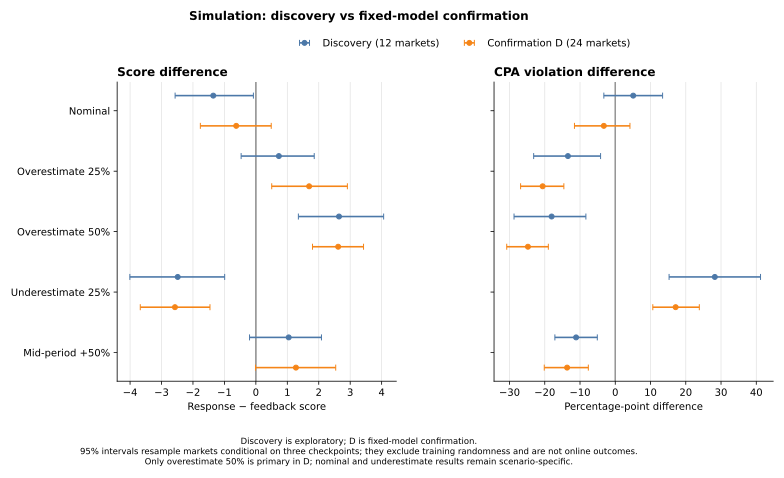

# TrajectoryLab

**Controllable generative bidding: response forecasts, budget/CPA control and reproducible stress evaluation.**

[中文](README.zh-CN.md) · [Research position](docs/bidding-research-map.md) ·
[Bidding protocol](docs/bidding-protocol.md) · [Architecture](docs/architecture.md)

[CPU checks](https://github.com/KAMCHIU-LAB/trajectory-lab/actions/workflows/ci.yml) ·
[v0.2.0 reproduction guide](docs/reproduce.md) · [Change log](CHANGELOG.md)

## Start here

- **Confirmed scope:** under 50% pCVR overprediction, three frozen response models in 24 fresh simulated markets achieved score **+17.6%**, conversions **+8.4%**, and CPA violations **−24.8 pp** versus frozen feedback. [Statistics and failure boundaries](docs/bidding-findings.md).
- **Generative branch:** conditional Flow Matching, quantile screening and feedback fallback are implemented. The second training seed failed the registered business gate; distribution-specific decision value remains unconfirmed. [Completed seed replication and mechanism audits](docs/bidding-generative-findings.md).
- **Delayed feedback:** a separate 24-market confirmation found posterior imputation score **+1.21%** (95% interval **[+0.41%, +2.05%]**), below the registered +3% practical target. Long-delay overprediction lost 4.25%; the common-trajectory audit explains why estimation and control need separate tests. [Results and limits](docs/bidding-delayed-findings.md).
- **How the research evolved:** [fourteen evidence-linked stages](docs/bidding-research-journal.md) connect problems, hypotheses, controls, outcomes and decisions; [a recording template](docs/experiment-record-template.md) keeps future work traceable. The journal is in Chinese.
- **Inspect the work:** [market settlement](src/trajectorylab/bidding/market.py), [response learning](src/trajectorylab/bidding/learning.py), [Flow sampler](src/trajectorylab/bidding_generative_learning.py), and [public evidence records](reports/bidding-generative/README.md).

## Try the public path

From a source checkout with Python 3.11 or 3.12:

```bash
python -m pip install -e '.[dev]'
python scripts/run_bidding_delayed_smoke.py --output artifacts/public-replay-v0.2.0
python scripts/verify_release.py --replay artifacts/public-replay-v0.2.0/smoke-evidence.json
```

No GPU, account or external dataset is needed after dependency installation.
Expected: 90 validation rows, 45 confirmation rows, mature settlement and hard
budget checks both `true`, business target `false`. This is a one-market software
replay, not a replication of the historical performance claims. Repeating the
command checks frozen resume. [Setup, expected outputs and troubleshooting](docs/reproduce.md).

## The question

A bidder sees predicted conversion probabilities, spends a finite budget and
receives noisy conversion feedback. When those predictions drift, does a learned
response model help it recover a better conversion–CPA trade-off than a tuned
fixed multiplier or a simple feedback controller?

This project studies that question with public AuctionNet traffic and auction
code. A compact causal model predicts action-conditioned cost/conversion curves;
a separate numerical controller chooses the bid. Keeping those pieces separate
allows matched-checkpoint experiments on forecast correction and control rules.
There is currently no LLM planner in the implemented system.

## Evidence so far

| Study | Status and evidence |
| --- | --- |
| [Bidding feasibility study](reports/bidding-pilot/report.html) | Completed: 480 campaign-level evaluations, one training seed. It did **not** establish a learned-policy advantage; fixed bidding was competitive and hard predicted-CPA constraints suppressed spend. |
| [Formal bidding study](reports/bidding-main/report.html) | Complete: 16 / 6 / 12 training / validation / test markets, three training seeds and 6,480 rows. History correction did not establish a score gain; response-model performance depended on the stress scenario. |
| [Controller refinement](reports/bidding-control/validation-report/report.html) | Validation complete: 11,340 candidate evaluations. The new controller failed the predeclared promotion gate; no new-market confirmation was conducted. |
| [Matched forecast audit](reports/bidding-forecast/report.html) | Complete: neural, contextual ridge and empirical forecasts on identical validation trajectories. Lower prediction error does not guarantee accurate conversion totals or better bidding. |
| [Chosen-action and pacing audit](reports/bidding-onpolicy/report.html) | Complete: 1,080 campaigns replayed exactly. Examines selected actions, forecast-bias direction and early budget spend; a post-hoc validation diagnostic, not a causal result. |
| [Independent new-market confirmation](reports/bidding-confirmation/report.html) | Complete: 24 new markets and 4,320 rows. Original response passed the frozen score, conversion-retention, violation and seed-consistency gates under 50% overprediction. The failed controller gate remains closed. |
| [Generative response development](docs/bidding-generative-findings.md) | Stopped at training seed 23 on six existing development markets; business replication and generative-value gates failed. Includes completed zero-fit mechanism audits. |
| [Delayed-feedback estimation and control](docs/bidding-delayed-findings.md) | Complete: 24 fresh markets, 19,440 campaign rows, seven protection endpoints passed, +3% practical target failed. Includes a 1,296-trajectory matched pending audit, source hashes and a small CPU replay. |
| [Pending-use strategy comparison](docs/bidding-delayed-strategy-findings.md) | Complete: twelve configurations on six existing development markets. Half correction offered the best trade-off, but only +0.30% score versus the stronger fixed reference; no candidate passed and no fresh confirmation opened. |
| [Information and feedback-coordination ablations](docs/bidding-evolution-audits.md) | Complete and independently checked: causal winner-log information on four training markets, and a control-mechanism comparison on four training/six seen development markets. Both candidates failed their frozen gates; scalar evidence and comparison plots are exported. |
| [Action-decoder structural comparison](docs/bidding-decoder-findings.md) | Complete: three matched 2,000-update arms; the product-feature candidate failed the frozen prediction gate against strong controls. Policy evaluation was skipped. |
| [Offline policy-learning foundation](docs/results.md) | Completed: 39 BC/IQL/DT training runs across Pendulum, a public PointMaze subset and an IQL mechanism ablation. |

Campaigns within a market and repeated methods/seeds are correlated. Row counts
are not independent-market counts. The [findings](docs/bidding-findings.md) retain
negative results, compute measurements and unresolved mechanisms.

**A replicated, scoped result:** in 24 fresh simulated markets under 50% pCVR
overprediction, frozen response scored **17.6% higher**, with **8.4% more
conversions** and a **24.8 percentage-point lower CPA violation rate** than
frozen feedback. The score difference was +2.617, with a market-bootstrap 95%
interval of [1.801, 3.424]; all three fixed-model score differences were positive.
The new allocation was frozen after the original discovery and before generation.
Intervals are conditional on those three checkpoints. Nominal score was 3.8%
lower (difference interval crossed zero), and underprediction score was 17.3%
lower. These results do not establish universal or production gains, and do not
change the failed history-correction and paced-controller findings.
[Full statistics and failure boundaries](docs/bidding-findings.md).



## What to inspect

| Part | Implementation and purpose |
| --- | --- |
| Exact auction response cache | [Market adapter](src/trajectorylab/bidding/market.py): public-kernel outcomes on a declared action grid, reused across policies with common random outcomes |
| Learned policies | [Training and rollout](src/trajectorylab/bidding/learning.py): a causal DT and a monotone response model; normalization fitted on training markets only |
| Forecast versus controller | [Paced control study](src/trajectorylab/bidding_control.py): same neural checkpoints, alternative controllers, empirical response curves and full simple-baseline grids |
| Feedback boundary | Current observations and past realized outcomes only; budget-censored outcomes are excluded from unthrottled forecast-ratio updates |
| Delayed reports | [Event ledger](src/trajectorylab/bidding_delayed_experiment.py) and [pending estimator](src/trajectorylab/bidding_pending_response.py): reporting-time boundaries, mature-history calibration and final-label settlement |
| Evidence and recovery | Source/configuration fingerprints, optimizer/RNG checkpoints, market-paired comparisons, raw CSV/JSON and text-only publication exports |

The response model receives dense simulated intervention labels; DT learns from
behavior trajectories. Their comparison does not isolate architecture alone.
The [protocol](docs/bidding-protocol.md) specifies the information available to
each method, the primary comparison and the exploratory analyses.

## Run the original neural bidding studies

Start from the repository root. For these studies, the reference environment is Python 3.12 on an
Apple M1; bidding configurations request MPS. A different device must be declared
in a separate local configuration and produces a different experiment identity.

```bash
python3.12 -m venv .venv
source .venv/bin/activate
python -m pip install -e .
python -m trajectorylab.bidding --config configs/bidding-pilot.toml
```

This performs real data generation, training and evaluation. The pilot is for
feasibility, not a performance claim. Its output directory is printed in the log.
For full studies, staged execution, checkpoint recovery and battery-aware
background operation, see the [bidding runbook](docs/bidding-runbook.md).

To inspect the committed reports without installing ML dependencies:

```bash
python3 -m http.server 8765 --bind 127.0.0.1 --directory reports
# Open http://127.0.0.1:8765
```

Reports need no account, API key or live backend. Public exports omit model
weights, traffic arrays, local logs and runner state. GitHub displays HTML source;
serve reports locally to view them.

For a small CPU-only delayed-report replay, run:

```bash
PYTHONPATH=src python scripts/run_bidding_delayed_smoke.py
```

This checks the public chain and resume identities with a tiny configuration;
it is not a performance replication. The [delayed-feedback protocol](docs/bidding-delayed-protocol.md)
gives the full staged commands, assumptions and evidence inventory.

## Earlier policy-learning studies

These are supporting experiments in trajectory selection and implementation
correctness, rather than evidence of advertising performance.

- **Pendulum:** high-return selection improved BC/IQL in all three paired seeds.
  DT's mean difference was +34.55 with a paired-difference SD of 67.85 and only
  2/3 positive seeds; this does not establish a stable DT gain.
- **PointMaze:** DT had higher mean return, while all methods reached a saturated
  100% “ever reached the goal” metric.
- **IQL ablation:** zero advantage temperature recovers the matched BC actor
  under the declared implementation and seeds.

[Results and limitations](docs/results.md) ·
[Reproduce these studies](docs/offline-policy-guide.md) ·
[Offline-learning protocol](docs/protocol.md)

## Scope and attribution

This is a custom fixed-opponent simulation derived from AuctionNet, with a custom
hard-budget settlement rule. It is not an official leaderboard reproduction;
opponents do not adapt or exhaust budgets. Simulator scores do not establish
production revenue or causal business impact. No employer code, data, internal
integrations or online metrics are included.

[Code/data provenance and publication boundary](docs/code-and-data-provenance.md).

## References and attribution

- [AuctionNet source and retained license](third_party/auctionnet/README.md).
- [GRM: Constrained Auto-Bidding via Generative Response Modeling](https://arxiv.org/abs/2605.27811), the response-model research reference. This compact implementation does not reproduce the full paper.
- [AIGB-R1](https://arxiv.org/abs/2607.17281), context for planner/executor bidding agents. Its LLM planner, PromptDT and D-GRPO are not implemented here.
- [IQL](https://arxiv.org/abs/2110.06169), [Decision Transformer](https://arxiv.org/abs/2106.01345), [Gymnasium Pendulum](https://gymnasium.farama.org/environments/classic_control/pendulum/) and the [Minari PointMaze dataset](https://minari.farama.org/main/datasets/D4RL/pointmaze/umaze-v2/).

The algorithms are public methods; the project contributes an independent
implementation and inspectable experiments. Development used AI-assisted coding.
Code uses [MIT](LICENSE); the AuctionNet subset retains its separate
[Apache-2.0 terms](third_party/auctionnet/README.md). Upstream datasets retain
their own terms and are not redistributed.
