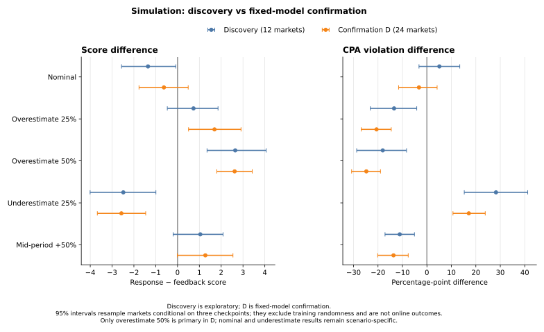

# TrajectoryLab

**可控生成式出价：响应预测、预算 / CPA 控制与可复核的压力评测。**

[English](README.md) · [研究定位](docs/bidding-research-map.md) ·
[出价实验协议](docs/bidding-protocol.md) · [架构](docs/architecture.md)

## 先看这里

- **已确认的局部收益：**高估 50% 时，3 个冻结响应模型在 24 个新模拟市场相对冻结反馈的 score **+17.6%**、转化 **+8.4%**、CPA 违约频率 **−24.8 个百分点**。[统计口径及失败边界](docs/bidding-findings.md)。
- **生成式分支：**已实现条件 Flow Matching、分位筛选与反馈回退；第二训练种子未通过业务门槛，生成分布带来的额外决策价值尚未确认。[已完成的种子复核与机制诊断](docs/bidding-generative-findings.md)。
- **实现入口：**[拍卖结算](src/trajectorylab/bidding/market.py)、[响应学习](src/trajectorylab/bidding/learning.py)、[Flow 采样器](src/trajectorylab/bidding_generative_learning.py)、[公开记录](reports/bidding-generative/README.md)。

## 研究什么

出价策略看到的是预测转化率，花掉的是真实预算，收到的转化反馈又有噪声。
当预测发生偏移时，学习到的响应模型能否比调过参的固定乘数、简单反馈控制器，
取得更好的转化与 CPA 约束权衡？

本项目用公开 AuctionNet 流量生成器和拍卖代码研究这个问题。
小型因果序列模型预测候选动作对应的成本 / 转化曲线，独立的数值控制器选择出价。
把预测与控制分开，才能在同一模型检查点下判断反馈修正、决策规则各自的作用。
当前实现中没有 LLM 规划器。

## 当前证据

| 研究 | 状态与可查看的证据 |
| --- | --- |
| [出价可行性实验](reports/bidding-pilot/report.html) | 已完成：1 个训练种子，480 条广告主周期评估记录。**尚未证明学习策略更优**；固定出价有竞争力，硬筛预测 CPA 会压低消耗。 |
| [正式出价实验](reports/bidding-main/report.html) | 已完成：16 / 6 / 12 个训练 / 验证 / 测试市场，3 个训练种子，6,480 条记录。历史修正未证实 score 改善；响应模型的优势取决于压力场景。 |
| [控制器诊断](reports/bidding-control/validation-report/report.html) | 已完成验证：11,340 条候选评估记录；新控制器未通过预设晋级门槛，没有开展新市场确认。 |
| [同口径预测审计](reports/bidding-forecast/report.html) | 已完成：相同验证轨迹上比较神经模型、上下文 ridge 和经验曲线。预测误差更小，不保证转化总量准确或出价收益更高。 |
| [所选动作与预算节奏审计](reports/bidding-onpolicy/report.html) | 已完成：1,080 个周期精确重放。检查控制器实际选择的动作、预测误差方向和早期预算消耗；属于事后验证诊断，不是因果证明。 |
| [新市场独立确认](reports/bidding-confirmation/report.html) | 已完成：24 个新市场、4,320 条记录。高估 50% 场景下，原 response 通过冻结的 score、转化保留、违约和种子一致性门槛；失败控制器的门槛仍未通过。 |
| [生成式响应开发复核](docs/bidding-generative-findings.md) | 复用 6 个开发市场，按规则在训练种子 23 后停止；业务复现与生成增量均未通过，附已完成的零拟合机制审计。 |
| [离线策略学习基础实验](docs/results.md) | 已完成：Pendulum、公开 PointMaze 子集和 IQL 机制消融，合计 39 次 BC / IQL / DT 训练。 |

同一市场内的广告主、不同方法和重复种子之间存在相关性，记录条数不是独立市场数。
[实测发现](docs/bidding-findings.md)保留负结果、计算成本和待验证的机制解释。

**一个获得独立支持的局部结果：**在 24 个全新模拟市场的 pCVR 高估 50% 场景，
冻结 response 相对冻结反馈基线的 **score 高 17.6%、转化高 8.4%、CPA 违约频率低
24.8 个百分点**。score 差为 +2.617，市场 bootstrap 95% 区间为 [1.801, 3.424]；
三个固定模型的 score 差均为正。新市场方案在旧结果发现后、新数据生成前冻结，
区间条件于这三个检查点。名义场景 score 低 3.8%（差值区间跨零），低估场景低
17.3%，不能宣传全面领先或线上收益；历史修正和新控制器的负结果仍然保留。
[查看完整统计口径和失败边界](docs/bidding-findings.md)。



## 值得检查的实现

| 部分 | 实现及作用 |
| --- | --- |
| 精确拍卖响应缓存 | [市场适配器](src/trajectorylab/bidding/market.py)：在声明的动作网格上缓存公开内核输出，各策略复用相同随机市场结果 |
| 学习策略 | [训练与执行](src/trajectorylab/bidding/learning.py)：因果 DT、单调响应模型；归一化只拟合训练市场 |
| 预测与控制的分离 | [逐时段控制研究](src/trajectorylab/bidding_control.py)：同一检查点比较控制器、经验响应曲线，以及完整的简单策略参数网格 |
| 反馈信息边界 | 策略只接收当前观测和过去实际反馈；发生预算截断的反馈不进入未截断预测的比例修正 |
| 证据与恢复 | 源码 / 配置指纹、优化器与随机状态检查点、按市场配对统计、原始 CSV / JSON 和可公开的文本导出 |

响应模型使用模拟器干预产生的密集反事实标签，DT 使用行为策略轨迹，两者监督不同，
不能直接把分数差归因于架构。各方法能看到什么、主比较是什么、哪些分析属于探索，
都写在[实验协议](docs/bidding-protocol.md)中。

## 本地运行

在仓库根目录执行。参考环境是 Apple M1、Python 3.12，出价配置使用 MPS。
其他设备需在独立本地配置中明确声明，形成新的实验身份。

```bash
python3.12 -m venv .venv
source .venv/bin/activate
python -m pip install -e .
python -m trajectorylab.bidding --config configs/bidding-pilot.toml
```

这会真实生成数据、训练并评估，输出目录在日志中打印。Pilot 用于检查链路，不能证明算法优势。
完整实验、分阶段执行、断点恢复和低电量后台运行见[运行指南](docs/bidding-runbook.md)。

只查看已提交的报告，无需安装机器学习依赖：

```bash
python3 -m http.server 8765 --bind 127.0.0.1 --directory reports
# 打开 http://127.0.0.1:8765
```

报告不依赖账号、API Key 或在线后端。公开导出不包含模型权重、流量数组、本机日志和运行器状态。
GitHub 显示 HTML 源码，查看页面请本地启动上述服务。

## 离线策略学习基础

这部分展示轨迹选择、算法实现和实验判断能力，分数只描述对应模拟任务。

- **Pendulum：**高回报筛选使 BC / IQL 的三个配对种子都上升；DT 平均差为 +34.55，
  但差值标准差为 67.85，仅 2/3 种子上升，不能认为收益稳定。
- **PointMaze：**DT 平均回报较高，但所有方法的“是否曾到达目标”成功率都是 100%，指标已经饱和。
- **IQL 消融：**优势温度设为零时，在声明的实现和种子下恢复匹配的 BC actor 更新。

[结果与限制](docs/results.md) · [复现实验](docs/offline-policy-guide.md) ·
[离线学习协议](docs/protocol.md)

## 适用范围与来源

这是从 AuctionNet 派生的自定义固定对手模拟，采用自定义硬预算结算规则。
对手不适应策略，也不执行自身预算；项目不是官方排行榜复现。
模拟分数不能直接证明生产收益或业务因果效果。仓库不包含雇主代码、数据、内部集成或线上指标。

- [AuctionNet 来源与保留许可](third_party/auctionnet/README.md)。
- [GRM](https://arxiv.org/abs/2605.27811)：响应建模路线的研究参考，本项目未复现完整论文。
- [AIGB-R1](https://arxiv.org/abs/2607.17281)：规划 / 执行式出价 Agent 的研究背景，当前没有实现其 LLM Planner、PromptDT 或 D-GRPO。
- [IQL](https://arxiv.org/abs/2110.06169)、[Decision Transformer](https://arxiv.org/abs/2106.01345)、[Gymnasium Pendulum](https://gymnasium.farama.org/environments/classic_control/pendulum/) 与 [Minari PointMaze](https://minari.farama.org/main/datasets/D4RL/pointmaze/umaze-v2/)。

算法来自公开方法，项目贡献是独立实现和可检查的实验；开发使用了 AI 编程辅助。
代码使用 [MIT](LICENSE)，AuctionNet 子集保留独立的 [Apache-2.0 条款](third_party/auctionnet/README.md)，
上游数据遵循各自条款，不在仓库重新分发。
