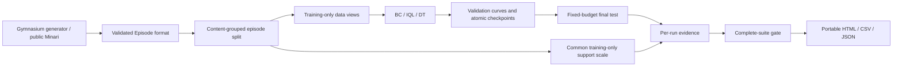

# Architecture

## Modules

| Module | Responsibility |
| --- | --- |
| `data.py` | Episode schema, integrity, generator, Minari adapter, split/views |
| `models.py` | Shared Gaussian actor, twin Q, causal transformer |
| `algorithms.py` | Public algorithm losses, samplers and optimizer state |
| `evaluation.py` | Environment recovery, fixed-seed evaluation, support distances |
| `config.py` | TOML defaults and validation |
| `experiment.py` | Fingerprinted experiment identities, execution and checkpointing |
| `report.py` | Completeness checks, training-seed aggregation, evidence export |
| `cli.py` | Local command-line entry points and localhost-only report serving |

The project deliberately uses straightforward modules and explicit configuration.
There is no distributed orchestration service, model-provider integration, secret
manager or plugin framework. A new algorithm should add a small learner path and
correctness tests; a new dataset should satisfy the same Episode contract.

## Storage

- `artifacts/datasets/`: compact, checksummed local data caches, without pickle.
- `artifacts/minari/`: public upstream downloads, excluded from Git.
- `artifacts/suites/`: manifests, optimizer/RNG checkpoints and run evidence.
- `reports/`: selected portable results for review and eventual publication.

`torch.load(..., weights_only=True)` is used for checkpoints. Load only checkpoints
you trust; no external checkpoint is needed to reproduce the experiments.

Run commands from the repository root. CLI defaults Minari's cache to the project's
artifact directory, while respecting an explicitly configured cache location.
