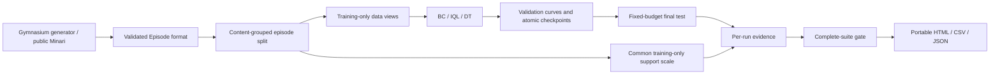

# Architecture

## Generative bidding

The bidding track separates prediction, action selection and auction settlement.
This makes it possible to change a controller while holding the response model
and market outcomes fixed. It currently uses numerical policies, not an LLM.

```mermaid
flowchart LR
    A[Public AuctionNet traffic and auction kernel] --> B[Exact intervention response tapes]
    B --> C[Disjoint training / validation / test markets]
    C --> D[Training-only behavior trajectories and response labels]
    D --> E[Causal DT / monotone response model]
    E --> F[Validation-only checkpoint and controller selection]
    F --> G[Policy: current observations and past feedback]
    G --> H[Hard-budget settlement]
    H -->|Realized feedback| G
    B --> H
    H --> I[Market-paired evaluation and public text export]
```

The policy cannot inspect the response tape. At decision time it receives the
current tick's traffic summaries and its own previous execution feedback. The
settlement layer alone looks up the chosen action's outcome. Dense labels for
unchosen actions are available to supervised training and offline analysis, not
to an evaluated policy. Future response labels never enter the observation.

| Module | Responsibility |
| --- | --- |
| `bidding/market.py` | Public-kernel adapter, exact action cache, observations and budget settlement |
| `bidding/learning.py` | Behavior trajectories, causal models, checkpointed fitting and policy rollout |
| `bidding/experiment.py` | Source/runtime identity, disjoint market splits, validation selection and first-study execution |
| `bidding/report.py` | Complete-result checks, market-paired summaries and portable report |
| `bidding_control.py` | Matched-checkpoint paced control, empirical forecast comparator, validation gate and optional new-market confirmation |
| `bidding_context.py` / `bidding_predictive.py` | Training-only contextual ridge and matched validation forecast diagnostics; no policy-value inference |
| `bidding_onpolicy.py` | Post-hoc replay audit of forecasts at the actions chosen by frozen policies; no fitting or causal attribution |
| `bidding_confirmation.py` | Fresh-market response-versus-feedback confirmation, with all-market data barrier and fixed decision gates |
| `scripts/run_bidding*_background.py` | Process supervision, low-battery pause/resume and process-bound wake assertions |
| `scripts/export_bidding*.py` | Declared text allowlists, evidence consistency checks and privacy screening |
| `scripts/package_bidding_replay.py` | Local candidate archive of allowlisted frozen inference inputs; no automatic publication |

Three different records serve different purposes: the **experiment identity**
pins sources, configuration and runtime; **checkpoints** preserve optimizer and
random state for recovery; the **public export** contains inspectable text
evidence without traffic arrays, model weights or machine logs. Reusing a result
directory with different declared sources/configuration is rejected.

The second study reuses the first study's frozen response checkpoints. Its
candidate controller must pass a declared validation gate before any new
confirmation markets are generated. A failed gate is a completed negative
validation result. See the [first protocol](bidding-protocol.md),
[controller protocol](bidding-control-protocol.md) and [runbook](bidding-runbook.md).

Confirmation D is a separate question: whether the original response-versus-feedback
discovery persists in 24 fresh markets. It holds three previously trained models
fixed, generates and seals every market before evaluating a policy, and applies
one primary scenario's declared gates. It does not reopen the failed controller
study. See the [confirmation protocol](bidding-confirmation-protocol.md).

## Offline policy-learning foundation

### Modules

| Module | Responsibility |
| --- | --- |
| `data.py` | Episode schema, integrity, generator, Minari adapter, split/views |
| `models.py` | Shared Gaussian actor, twin Q, causal transformer |
| `algorithms.py` | Public algorithm losses, samplers and optimizer state |
| `evaluation.py` | Environment recovery, fixed-seed evaluation, support distances |
| `config.py` | TOML defaults and validation |
| `experiment.py` | Fingerprinted experiment identities, execution and checkpointing |
| `report.py` | Completeness checks, training-seed aggregation, evidence export |
| `cli.py` | Local command-line entry points and localhost-only report serving |

These modules use straightforward local functions and explicit configuration.
A new dataset must satisfy the Episode contract before entering this pipeline.

## Storage

- `artifacts/datasets/`: compact, checksummed local data caches, without pickle.
- `artifacts/minari/`: public upstream downloads, excluded from Git.
- `artifacts/suites/`: manifests, optimizer/RNG checkpoints and run evidence.
- `artifacts/bidding/`: local market tapes, bidding checkpoints and study state.
- `reports/`: selected portable results for review and eventual publication.

The bidding checkpoint loader uses `weights_only=False` for its own training
metadata. Load only trusted, hash-verified checkpoints. Running the public training
pipeline needs no external model checkpoint; replaying the exact frozen models
requires their matching inference files, which are currently a local publication
candidate. Public reports alone support evidence inspection, not exact frozen-model
replay. See the [reproduction scopes](bidding-runbook.md#复现范围).

Run commands from the repository root. CLI defaults Minari's cache to the project's
artifact directory, while respecting an explicitly configured cache location.
