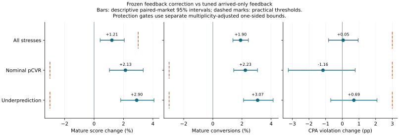
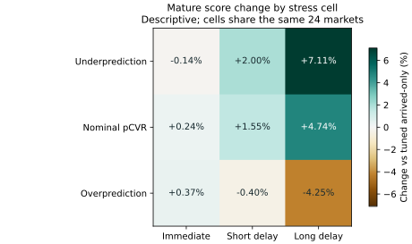

# Delayed feedback: better estimates need a separate decision test

This study extends the bidding project from prediction bias to unfinished
conversion feedback. Its contribution is an exact reporting boundary, a common
controller comparison, frozen selection and inspectable evidence about the gap
between estimating outcomes and controlling CPA. It does not establish a new
generative bidding algorithm.

[Protocol and full reproduction](bidding-delayed-protocol.md) ·
[Public scalar evidence](../reports/bidding-delayed-feedback/README.md)

The subsequent [bounded control extension](bidding-delayed-strategy-findings.md)
completed twelve configurations on the old six development markets. Half
correction was the best trade-off, but its +0.30% gain versus the stronger fixed
reference failed the +3% promotion target; no new confirmation opened. This
study's 24 confirmation markets remain sealed for extension selection.

## Development decision

Four public training markets supply mature delay history. Six previously seen
development markets select among four gain/prior configurations for each of five
estimators. These are 19,440 campaign records, not 19,440 independent markets.
Every estimator selected gain `0.3` and prior `8`; the strongest deployable point
reference was posterior-mean imputation.

| Selected estimator | Mean mature development score |
| --- | ---: |
| Arrived-only feedback | 14.807459 |
| Maturity/prior imputation | 14.997393 |
| Delay-corrected MAP | 14.963336 |
| Posterior mean | 14.999058 |
| Past-outcome diagnostic, unavailable in deployment | 14.977571 |

The selected posterior-mean controller improved development macro score by
1.294% over the selected arrived-only controller. The past-outcome diagnostic
scored 0.143% below that point reference and changed 5.937% of actions. Both
registered investment requirements failed: at least +2% diagnostic score and at
least 10% different actions. No new neural generator was trained in this stage.

This is a stopping decision within the declared feedback-controller family.
The diagnostic is not an optimal controller: knowing past outcomes does not
make its heuristic globally optimal, and noisy realized counts need not be the
best regularized feedback signal. Its failure does not show that better
policies or distribution-based decisions cannot exist. A future generative
claim would require a joint action-conditioned cost/conversion distribution
and a separate decision-value comparison against strong point methods.

## Independent confirmation

The frozen five methods completed 19,440 campaign evaluations in 24 unused
markets (`6101..6124`). The primary comparison is the development-selected
posterior mean against development-selected arrived-only feedback. Both use
gain `0.3`, prior `8` and the same action grid. Intervals below resample paired
markets 10,000 times; repeated campaigns are not independent replicates.

| Scenario mixture | Mature score change, 95% interval | Mature conversion change, 95% interval | CPA violation change, 95% interval |
| --- | ---: | ---: | ---: |
| All nine stresses | +1.21% [+0.41%, +2.05%] | +1.90% [+1.38%, +2.44%] | +0.05 pp [−0.82, +0.95] |
| Nominal pCVR, all delays | +2.13% [+1.04%, +3.34%] | +2.23% [+1.43%, +3.06%] | −1.16 pp [−3.24, +0.77] |
| Underprediction, all delays | +2.90% [+1.81%, +4.07%] | +3.07% [+2.11%, +4.14%] | +0.69 pp [−0.69, +2.08] |

All seven Bonferroni-adjusted protection endpoints passed. The adjusted
CPA-violation upper bounds were +1.21 pp overall, +1.16 pp nominal and +2.47 pp
underprediction, below the +3 pp limit. Adjusted nominal/under score and
conversion lower bounds exceeded 97% retention.

**The full business gate did not pass:** the +1.21% macro score gain is below
the predeclared +3% practical target, although its paired 95% interval excludes
no change. This supports a small, scoped gain; it does not establish the
targeted practical effect or a generative-model advantage.

The cell means below describe the same 24 markets; they are not nine separate
independent confirmations or multiplicity-adjusted subgroup findings.

| Public pCVR stress | Immediate score change | Short-delay score change | Long-delay score change |
| --- | ---: | ---: | ---: |
| Underprediction | −0.14% | +2.00% | +7.11% |
| Nominal | +0.24% | +1.55% | +4.74% |
| Overprediction | +0.37% | −0.40% | −4.25% |

Long-delay overprediction is a material failure boundary: conversions rose
1.50%, while score fell 4.25% and CPA violations rose 2.31 pp. The registered
protection groups did not include a separate overprediction endpoint. Passing
those gates therefore cannot establish protection for every stress cell.

## Common-trajectory pending audit

The diagnostic exactly matched 1,296 selected-policy trajectories, using arrival
seed `11`, before recording 31,104 estimator/decision rows. At six fixed decision
ticks it applied all four estimators to identical observable cohorts. It did not
change or reselect the policy. For long delays, equally weighted across the
declared bias/focal/market/tick mixture:

| Estimator | Pending-count MAE |
| --- | ---: |
| Arrived-only | 2.9271 |
| Maturity/prior imputation | 1.3279 |
| Delay-corrected MAP | 1.2950 |
| Posterior mean | 1.2934 |

Posterior-mean MAE was 55.81% below arrived-only on these shared long-delay
trajectories, but only 0.12% below MAP. Posterior 80% central intervals covered
91.71% of pending-count labels; Monte Carlo CRPS was 0.8859. These are
descriptive, discrete-count calibration diagnostics conditional on the frozen
history and model, without market-cluster uncertainty intervals. Coverage
above 80% does not establish an exact nominal interval or a CPA safety bound.

The result motivates inspecting how estimates enter decisions. It provides
little observed reason to replace the small estimator with a neural generator
within this tested controller family.

## What the comparison controls

The ordinary policy sees public accepted-event probabilities, their ages and
reports received before the decision. It receives no true bias multiplier,
delay-regime label or unreported final conversion. The harness matches each
deployment context to its pre-existing mature training history. This assumes
stable historical delay; it does not identify an unknown delay process.

The calibration scale and reporting process are not learned jointly here.
Mature history fixes the reporting CDF, allowing the estimator to distinguish
unfinished feedback from final negatives under that assumption. A change in
conversion probability and a change in reporting speed can otherwise produce
similar early counts. Cold start, feature-dependent delay and simultaneous
calibration/delay drift need different evidence.

All methods share the action grid, exact hard-budget settlement and controller
function. Only the conversion total supplied to that controller changes. The
`mature_only` comparator needs special care: with a 48-tick campaign and a
48-tick maturity window, no live cohort matures before a decision. It remains a
prior-based imputation method throughout this campaign.

Posterior-mean imputation is a small parametric estimator. Drawing samples from
its posterior for an offline calibration diagnostic does not make the deployed
controller generative. The earlier Flow Matching branch and its failed
replication gates remain [separate evidence](bidding-generative-findings.md).

## Why estimation and control are different tests

Replacing unreported conversions with a conditional estimate changes the CPA
signal. Under this controller, that can permit more aggressive bids. Better
pending-count MAE therefore need not produce better final CPA compliance. Final
labels after the attribution window determine business metrics; predictions
cannot certify those outcomes.

More precisely, at fixed observed cost and elapsed time, its raw desired action
is proportional to `(V + prior)^gain`. Substituting `V=O+lambda*U` gives
`d log(action) / d lambda = gain*U/(O+lambda*U+prior) >= 0` for nonnegative U.
Clipping and nearest-grid projection preserve that weak ordering. This is a
structural property of the controller, not evidence that it explains every
between-policy outcome: policies subsequently buy different events and spend
different amounts. The control extension tests partial correction, inferred
calibration gating and explicit action calibration against that mechanism.

Pending errors collected during different policies' own trajectories are also
not a clean estimator comparison: their auctions and accepted events differ.
The offline diagnostic consequently replays the selected policy's exact frozen
trajectories and evaluates all four deployable estimators on the same public
cohorts. Truth is used only to score estimation error and interval coverage.

The independent confirmation keeps these tests distinct: practical macro score
gain, conversion/score retention in protected scenarios, CPA-violation bounds,
and a descriptive common-trajectory estimation audit. Passing one cannot
substitute for passing another.

## Scope

Auction traffic is generated from the public AuctionNet mechanism. Opponents are
fixed and synthetic reporting delays are injected independently of event
selection. This is neither an official AuctionNet leaderboard reproduction nor
a real-world delayed-conversion dataset. Results apply to the declared market
generator, historical contexts, action grid and controller family.

The study uses no employer code, employer data, internal integrations, LLM API
credentials or historical trained weights. Public evidence contains scalar
simulation results and source/configuration identities; traffic arrays, event
traces, local logs and machine paths are excluded.
