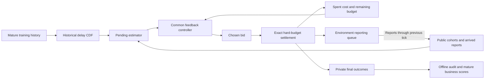

# Delayed feedback: observation, estimation and control

The experiment asks whether correcting unfinished conversion feedback improves
budget/CPA decisions when public pCVR is miscalibrated. A second question is
whether a distribution would change decisions enough to justify a learned
generator. Positive answers are not assumed.

## Environment and visibility

The public AuctionNet-derived, fixed-opponent auction and hard-budget settlement
are retained. This is a custom simulation, not an official benchmark or an
online advertising experiment. The extension changes when conversion labels
become visible; it does not simulate user-level conversion occurrence times.

There are 48 opportunity ticks and a 48-tick attribution/maturity window. An
accepted positive event from tick `j` is reported at `j + D`. A decision at tick
`t` can consume reports through `t - 1`. Consequently, `D=0` is visible at the
next decision, matching the original arrived-only feedback path. After the last
opportunity the environment flushes pending reports through `H+W`; no new
auctions occur. All business metrics use final mature labels.

The policy receives accepted event probabilities, ages, arrived conversion
counts, spent cost, remaining budget and target CPA. Environment-owned positive
IDs, unfinished final outcomes, future opportunities and the injected pCVR
multiplier never enter ordinary policy inputs. The explicitly nondeployable
`oracle_past` diagnostic can see final outcomes of **past** accepted events.

Latent outcomes and delays are stable by market, focal bidder, event and arrival
seed. They do not depend on policy call order. The settlement prefix contains
only events actually paid for within the remaining budget.



Private final outcomes have no ordinary-policy input path. The separately
labelled `oracle_past` diagnostic is the sole deliberate exception.

## Historical context assumption

Each deployment context supplies its own mature training history, generated
before evaluation under the same stable reporting process. A separate empirical
delay CDF is fitted from selected-winner positive events in four training
markets. All estimators receive that same history. The policy receives the
fitted CDF, not test-event delays, their generating parameters or a regime label.
The harness uses context names to select the corresponding pre-existing history.

This conditional design does not identify an unknown delay regime, demonstrate
adaptation to delay drift, or solve cold start without mature historical labels.
Winner selection and reporting delay are independent in this synthetic process.
That simplification should be reconsidered for real data.

## Estimators

Let `q` be an event's final conversion probability and `F(age)` the historical
probability that a positive event has already reported. For an unreported event,

```
P(final positive | not yet reported, age) = q * (1 - F(age)) / (1 - q * F(age))
```

Accepted events are grouped by birth tick and four public-pCVR bins with edges
`0.0001, 0.0005, 0.002`. Within a group, its mean public probability replaces
heterogeneous event probabilities: a documented binomial working approximation.
An 81-point calibration grid from 0.3 to 2 scales that probability. A lognormal
prior with log standard deviation 0.5 regularizes sparse observations. The
empirical CDF adds a total pseudocount of 0.5 across delays `0..48`.

| Method | Conversion total supplied to the common controller |
| --- | --- |
| Arrived-only (`naive`) | Reports already received |
| Maturity/prior imputation (`mature_only`) | Arrived count plus pending estimate; calibration updates only from fully mature live cohorts |
| Delay-corrected point (`delay_corrected`) | Arrived count plus pending estimate at the calibration MAP |
| Posterior mean (`posterior`) | Arrived count plus pending estimate averaged over calibration uncertainty |
| Past-outcome diagnostic (`oracle_past`) | Actual final conversions from past accepted events; unavailable in deployment |

With `H=W=48`, **no live cohort is fully mature before a decision**. Thus
`mature_only` retains the prior MAP throughout the live window. It is a
prior-imputation comparator, not evidence that current calibration can be
learned by waiting for mature live data. The posterior is not a proven safety
bound, and posterior-mean control is not a generative bidding policy.

## Frozen comparison

All estimators use the same feedback control function and declared action grid.
Each receives four gain/prior configurations: `(0.3,8), (0.7,8), (0.3,3),
(1.2,8)`. The best macro development score is selected within each estimator;
the strongest deployable selected estimator is the point reference `B*`.
Development uses six previously seen markets, without new-market claims.

The stress matrix crosses public prediction multipliers `0.75, 1, 1.5` with:

- Immediate reports: `D=0`.
- Short delay: geometric failures with `p=1/3`, capped at 48.
- Long delay: 25% immediate, otherwise geometric failures with `p=1/13`, capped
  at 48. The immediate probability also includes the geometric component's zero.

Each cell includes six focal bidders and arrival seeds `11,23,37`. The training
history uses a separate arrival seed, `731`.

The development investment gate requires the best past-outcome diagnostic to
exceed `B*` by at least 2% macro score and change at least 10% of actions. This
is an engineering stopping rule. Failure does not prove that no better policy
exists: the diagnostic retains the same feedback-controller family.

If that gate opens, a separate one-step joint `(past pending, next cost, next
conversions)` experiment is required before claiming distribution decision
value. Sampling pending outcomes alone does not satisfy that contract. The
existing Flow branch and its failed business gates remain separate evidence.

## Independent confirmation and inference

Twenty-four unused markets, `6101..6124`, are opened after selection freezes.
The primary P2 comparison is selected `B*` versus the development-tuned
arrived-only controller. It measures feedback correction, not generative novelty
or an advantage over `B*` itself. Other method comparisons are secondary.

Rows are averaged equally within each market over the declared stress mixture.
The independent unit is the market, not a campaign, arrival seed or method.
A paired 10,000-draw market bootstrap reports ratios of mean score and mature
conversions. The declared practical score target is +3%, with a 95% interval
strictly above no change. At least 24 independent markets are required.

Seven one-sided protection endpoints use Bonferroni-adjusted bounds: nominal
and underprediction score/conversion retention at least 97%, and CPA-violation
increase at most 3 percentage points in all/nominal/under groups. These finite
simulation intervals are approximate and conditional on the supplied historical
contexts and declared seeds; they are not production risk guarantees.

The mature score is `conversions * min(1, (target_CPA * conversions / cost)^2)`;
it is zero when conversions are zero. A CPA violation means
`cost > target_CPA * conversions`, including positive cost with zero conversions.
Hard-budget compliance and CPA compliance are different conditions. An increase
in average score cannot substitute for passing the CPA protection endpoints.

Source/configuration hashes, vendor identities, actual market-file hashes,
training-history hashes and selected parameters are frozen in manifests.
Changed cache contents invalidate resumed evaluation. Confirmation cannot be
used to reselect a controller.

## Reproduce the software path

From an installed checkout:

```bash
PYTHONPATH=src python scripts/run_bidding_delayed_smoke.py
```

This generates public traffic, fits training history, selects on a tiny
development set, evaluates a separate tiny confirmation set and verifies final
maturity and hard budgets. Its single confirmation market and few training
positives support a software replay claim only. It cannot pass the business
gate. Completed stages resume only with identical source and input identities.

The full configuration is [bidding-delayed-feedback.toml](../configs/bidding-delayed-feedback.toml).
The event adapter, estimator, experiment driver and statistics are separate
modules under `src/trajectorylab/bidding_delayed*` and
`src/trajectorylab/bidding_pending_response.py`.

### Full registered run

The following stages use the full configuration and its default output directory.
Preparation can take substantially longer than the small replay. Commands are
sequential; do not run multiple writers against the same output directory.

```bash
python -m trajectorylab.bidding_delayed_experiment --stage prepare --split train
python -m trajectorylab.bidding_delayed_experiment --stage history
python -m trajectorylab.bidding_delayed_experiment --stage prepare --split validation
python -m trajectorylab.bidding_delayed_experiment --stage evaluate --split validation
python -m trajectorylab.bidding_delayed_experiment --stage select
python -m trajectorylab.bidding_delayed_experiment --stage summary --split validation
```

Read `selection.json` before opening confirmation. In the registered development
selection the investment gate was closed, so the selected five methods proceeded
directly to confirmation. A reproduction that opens that gate would require the
separately specified distribution experiment before making a generative claim.

```bash
python -m trajectorylab.bidding_delayed_experiment --stage prepare --split confirmation
python -m trajectorylab.bidding_delayed_experiment --stage evaluate --split confirmation
python -m trajectorylab.bidding_delayed_experiment --stage summary --split confirmation
python scripts/audit_bidding_delayed_pending.py --output artifacts/bidding/delayed-feedback --destination artifacts/bidding/delayed-feedback/offline-pending-audit
python scripts/export_bidding_delayed_evidence.py --input artifacts/bidding/delayed-feedback --output reports/bidding-delayed-feedback
python scripts/plot_bidding_delayed_evidence.py --input reports/bidding-delayed-feedback
```

Use `PYTHONPATH=src` before each Python command if running without an editable
installation. Reuse an output directory only for an identical run. The exporter
rejects unexpected existing files; generate plots after the evidence export.
The plotting command also writes `publication-manifest.json`, hashing the
scalar export manifest and both SVGs. It verifies the exported scalar hashes
and rejects unlisted files. Export again to a fresh destination when changing
the publication bundle; do not mix local logs with public evidence.

The offline pending audit replays the selected controller's exact frozen actions
and evaluates all estimators on those same observed trajectories. It evaluates
pending-count MAE, discrete 80% interval coverage and Monte Carlo CRPS. Final
pending labels are scoring targets only. These conditional diagnostics neither
change the controller nor establish a risk guarantee. Each trajectory must
match the frozen business results before its diagnostic rows can be exported.

## Attribution

Auction traffic and the auction kernel retain the upstream
[AuctionNet attribution and license](../third_party/auctionnet/README.md).
Delayed-feedback research such as
[DEFUSE](https://arxiv.org/abs/2202.06472) motivates distinguishing unfinished
feedback from final negatives. This experiment is an independent, small
parametric implementation; it does not reproduce DEFUSE or validate bidding
uplift on its real-world conversion dataset.
