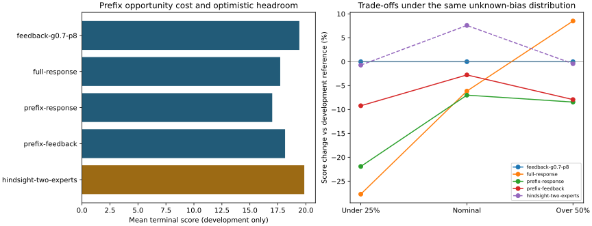

# Unknown-bias expert selection: the declared pair lacks practical headroom

Status: **`STOP_NO_HEADROOM`**, 2026-11-19. The registered development gate
closed this study before selector fitting. The 24 reserved confirmation markets
were neither generated nor opened. This is a development result, not a new
independently confirmed policy improvement.

## Question and experiment

Could 16 periods of visible feedback support one useful choice between the
frozen feedback expert (gain .3, prior 8) and response expert (seed 11), without
knowing whether pCVR is underpredicted, nominal or overpredicted?

The study generated **8 new training and 6 new development markets** from the
public AuctionNet-derived generator. Each market contains six focal advertisers
and three equally weighted probability multipliers: .75, 1 and 1.5. Feedback is
immediate; opponents are fixed and do not share exhaustible budgets. Markets,
not campaign rows, are the independent units.

Before new outcomes were analysed, commit `e61bda8` fixed the code, protocol,
expert and configuration. The experiment identity is
`de894f1ff6f2db13e274f384ca9e85badca411a9c51f8fc8297535edffc8df77`.
The [protocol](bidding-expert-selection-protocol.md) requires at least **+3%**
development headroom over the strongest cheap reference before fitting a
selector. It also defines subsequent candidate, protection, budget and
confirmation gates; none of those later gates was reached.

## Result against the strongest simple control

The development reference was **feedback gain .7 / prior 8**, selected from the
registered cheap controls. It beat the original gain-.3 feedback's score by
**7.02%** on this development split. Direct observable calibration was included;
its best configuration did not beat the selected feedback reference.

| Method | Mean score | Relative score | Under 25% | Nominal | Over 50% |
| --- | ---: | ---: | ---: | ---: | ---: |
| Strong feedback: gain .7 / prior 8 | 19.4200 | Reference | Reference | Reference | Reference |
| Original feedback / prefix-feedback | 18.1454 | −6.56% | −9.22% | −2.77% | −7.93% |
| Best direct calibration | 18.0276 | −7.17% | −3.79% | −13.21% | −4.09% |
| Full-day response | 17.7112 | −8.80% | −27.71% | −6.15% | +8.51% |
| Prefix then response | 16.9966 | −12.48% | −21.92% | −7.00% | −8.45% |
| Visible-ratio threshold .85 | 18.0523 | −7.04% | −9.22% | −3.21% | −8.97% |
| Hindsight best continuation, **not deployable** | 19.8615 | **+2.27%** | **−0.72%** | **+7.58%** | **−0.42%** |

All relative entries use the same selected development reference, within each
declared group. The [complete table](../reports/bidding-expert-selection/report.md)
retains all 24 methods, including weak fixed multipliers and every calibration
configuration. Selecting the reference and inspecting effects on this same split
makes these results exploratory.

The hindsight diagnostic chooses the higher full terminal score separately for
each campaign after seeing both outcomes. Its mean advantage is **2.2736%**, with
an exploratory market-bootstrap 95% interval **[−3.96%, +8.39%]**. That interval
does not establish a gain or a population upper bound. The point estimate is
below the registered practical gate, so `candidate_results=[]`: no ridge
candidate was fitted, selected or promoted. The interval's upper end is not a
reason to change the threshold or open confirmation.

## What this resolves

1. **The old comparison can overstate the opportunity for a new mechanism.**
   Hindsight was +9.46% versus the original feedback but only +2.27% versus the
   strongest registered cheap reference. The latter is the investment comparison.
2. **The timing of a decision is part of its value.** Full-day response retained
   an overprediction advantage on this split; prefix-then-response lost it.
   These are different trajectories. The observed difference motivates a future
   timing study, but does not identify a particular budget or calibration
   mechanism as its sole cause.
3. **Bias classification is not the acceptance target.** Even perfect knowledge
   of which continuation scores higher did not leave enough mean headroom for
   this pair and prefix on this split. Training a better bias classifier would
   not answer that practical limitation.
4. **Direct calibration is a measured competitor.** It received arrived feedback
   and accepted public probability sums, never the true error multiplier. Its
   failure here does not establish that all calibration approaches fail.

## What remains unanswered

- No selector was trained; learnability from the public features was **not**
  tested after the headroom stop.
- The hindsight diagnostic bounds only choices between these two completed
  continuations on these development campaigns. Other experts, earlier decisions
  or repeated decisions can change the available space.
- Equal weighting of three synthetic errors is not a production traffic mix.
  One frozen response seed and six development markets do not establish model
  training robustness or external validity.
- There is no new evidence for generative distributional value, delayed-feedback
  robustness, a shared-budget opponent model, LLM planning or online revenue.
- Historical overprediction confirmation remains scoped to its original
  reference, three checkpoints and protocol; this study does not broaden it.

The registered decision is to **retain the strong simple reference and stop this
selector identity**. A subsequent question would need a new protocol, frozen
expert/prefix choices and new development/confirmation allocation. No extra
thresholds or model families were searched after this result.

## Engineering evidence and cost

- The public clone/continuation environment matches the original immediate
  rollout period by period. All three numeric expert conversions matched legacy
  predictions and actions exactly on the declared legacy parity market.
- The new study produced **252 campaign contexts and 2,880 outcome rows**:
  144 training contexts × two continuations, plus 108 development contexts ×
  24 methods. These are not 2,880 independent observations.
- All evaluated outcomes passed hard-budget and final-maturity checks.
- Sequential input generation took **2,636.4 s (43.94 min)**; evaluation took
  **64.3 s**. Peak evaluation-process RSS was **0.844 GiB**. New compressed market
  caches occupied **1.959 GiB**. These are measurements on Apple M1 / 16 GiB,
  Python 3.12.13, CPU inference and two Torch threads; generation peak memory and
  full system memory are not included in the evaluation RSS number.
- Export recomputes the saved development decision without overwriting it,
  validates source/input identities and publishes only registered aggregate files
  and metadata fields. Confirmation claims require recomputation under its seal.

## Inspect or reproduce

- [Protocol and statistical limits](bidding-expert-selection-protocol.md)
- [Full source-checkout reproduction](bidding-expert-reproduction.md)
- [Design decisions and rejected shortcuts](bidding-expert-decisions.md)
- [Aggregate results](../reports/bidding-expert-selection/results.csv),
  [public features and paired targets](../reports/bidding-expert-selection/features.csv),
  [all statistics](../reports/bidding-expert-selection/summary.json) and
  [source/input/weight provenance](../reports/bidding-expert-selection/provenance.json)

The export includes no raw traffic, per-event labels, original pickle checkpoints
or local runtime logs. Public numeric expert assets originate from the declared
public-simulator study; see the [publication boundary](code-and-data-provenance.md).
