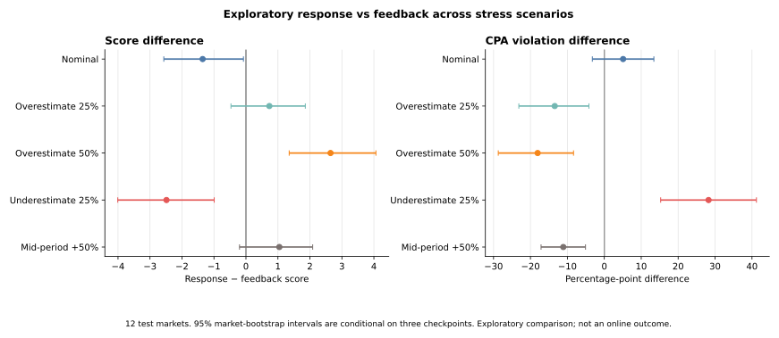
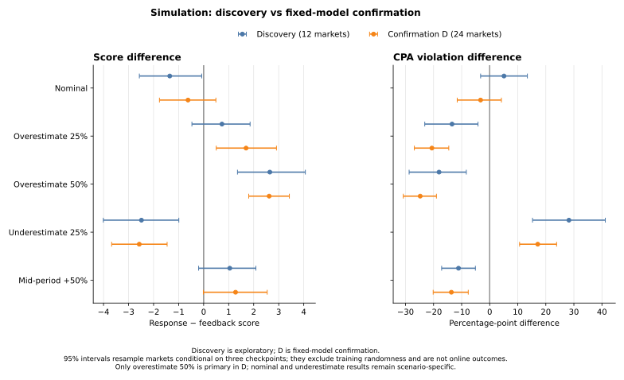

# 出价研究：结论、取舍与证据

正式实验、控制器验证和 24 个新市场的独立确认 D 已完成。证据来自公开 AuctionNet 派生的自定义固定对手模拟，
不能解释为官方基准、线上提升或对实际业务的因果结论。

## 先看结论

1. **主假设没有得到支持。**历史比例修正减少了一些 CPA 违约周期，也损失了转化；
   没有证实 score 改善，三个训练种子的 score 差均为负。
2. **响应模型的价值有场景边界。**在 pCVR 高估 50% 时，原始 response 相比验证集调参的
   feedback 有更好的 score、转化和违约频率，并在 24 个新市场通过预设确认门槛；
   低估场景仍明显更差。名义 score 点估计较低，但新确认区间跨零，不能宣传全面领先。
3. **换控制器没有自动变好。**同检查点的逐时段双价格控制在验证集明显退化，
   未通过预设晋级门槛；没有消耗资源生成 24 个确认市场。
4. **访问轨迹上的误差受动作和预算节奏影响。**对冻结策略在原验证轨迹进行的事后重放审计中，1,080 个周期的 score、cost、conversions、violation 均与原 control 验证记录一致。paced 首个时段的累计预算利用率为 43.8%，原 response 为 2.8%；所选动作下，当前转化预测总量比由 response 的 0.680 反转为 paced 的 1.997。paced 有 53.2% 的零动作时段，纳入全时段误差后会稀释活跃动作误差，因此全时段 MSE 接近并不表示预测质量相同。
5. **这些差异不能定位因果瓶颈。**两种策略访问不同状态并选择不同动作；这项事后验证轨迹诊断不能单独证明预测器、控制器或误差函数导致了策略差异。

## 正式实验：12 个未参与选择的测试市场

16 个训练市场、6 个验证市场、12 个测试市场（3101–3112）；
6 个受测广告主、3 个训练种子、5 种压力场景，每市场请求 500,000 PV，
实际为 499,975 PV。共 6,480 条评估记录，独立统计单元是市场，不是记录或时段。
DT 与 response 各训练三个种子、每种子 15,000 步；检查点只按验证损失选择。

[完整报告](../reports/bidding-main/report.html) ·
[原始 CSV](../reports/bidding-main/results.csv) ·
[配对统计与种子差异](../reports/bidding-main/summary.json) ·
[配置与源码身份](../reports/bidding-main/manifest.json) ·
[选择记录](../reports/bidding-main/selection.json)

### 主比较：over_50 中 correction − response

| 指标 | response | + correction | 配对均值差 | 市场聚类 95% bootstrap 区间 |
| --- | ---: | ---: | ---: | ---: |
| CPA 惩罚 score | 17.065 | 16.488 | −0.577 | [−1.275, 0.095] |
| 转化数 | 23.264 | 22.801 | −0.463 | [−0.926, −0.005] |
| CPA 违约频率 | 62.50% | 59.72% | −2.78 个百分点 | [−5.56, 0.00] 个百分点 |

三个种子（11 / 23 / 37）的 score 差分别为 −0.539 / −0.774 / −0.417。
平均 CPA 债务从 243.21 升至 270.91：违约频率减少不代表违约幅度同步减少。
因此不把“违约频率下降”单独包装成安全性提升，也不把转化减少忽略掉。

区间用 2,000 次市场级重采样，先在每个市场内平均广告主和训练种子。
它们条件于这三个检查点和同一次训练数据划分，不能量化完整训练随机性或模拟器分布的不确定性。
score 的定义为转化数乘以 CPA 超标惩罚，不能换称收入、ROI 或真实业务收益。

### 探索性比较：原始 response 与 feedback

反馈基线的 gain=0.3、prior=8，仅用验证集全场景平均 score 选择；
它不是为每个测试场景单独挑选的最优简单策略。

| 场景 | response score | feedback score | response 转化 | feedback 转化 | response / feedback 违约频率 |
| --- | ---: | ---: | ---: | ---: | ---: |
| 名义 pCVR | 15.398 | 16.752 | 20.903 | 19.569 | 62.04% / 56.94% |
| 高估 25% | 16.702 | 15.971 | 22.625 | 20.889 | 57.41% / 70.83% |
| 高估 50% | 17.065 | 14.421 | 23.264 | 21.639 | 62.50% / 80.56% |
| 低估 25% | 11.931 | 14.415 | 15.778 | 15.444 | 62.96% / 34.72% |
| 中途高估 50% | 16.929 | 15.885 | 22.954 | 22.194 | 58.33% / 69.44% |

高估 50% 时，score 差为 +2.644，区间 [1.352, 4.063]；转化差 +1.625，
区间 [0.546, 2.787]；违约频率差 −18.06 个百分点，区间 [−28.72, −8.33] 个百分点。
对应 score 相对差约 +18.3%、转化约 +7.5%，三个种子的 score 差均为正。
名义场景的 score 则低约 8.1%，低估 25% 时违约明显更多。
这些场景与方法比较未做多重比较校正，需新市场独立确认，不能回写为原来的主假设。

图中保留所有五种场景；原始点及生成器身份见[图表来源](../reports/bidding-analysis/figure.json)。

## 同检查点控制器研究：验证未晋级

复用原 response 的三个检查点，对照逐时段双价格控制、累计 / 折扣修正、预算价格消融、
训练市场拟合的经验响应、完整固定乘数与反馈参数网格。
六个验证市场产生 11,340 条候选评估记录；它们用于选择，估计本身有选择偏差。

选出的神经控制器为 `(eta_budget, eta_quality)=(10,10)`、不作比例修正：

| 验证范围 | 新控制器 score | 简单参考 score | 原 response score |
| --- | ---: | ---: | ---: |
| 五场景平均 | 6.392 | 15.574 | 15.385 |
| 高估 50% | 5.254 | 15.285 | 17.067 |

五场景平均转化为 13.781，违约频率为 95.93%；原 response 分别为 20.389 和 62.22%。
新控制器没有达到预设的 score、转化保留及违约门槛，状态为 `complete-not-promoted`。
没有生成或查看预留的 3201–3224 确认市场。结论只涉及已声明的候选与参数范围，
不能推广成“所有逐时段控制都无效”。

[验证报告](../reports/bidding-control/validation-report/report.html) ·
[冻结选择及晋级判断](../reports/bidding-control/selection.json) ·
[预设协议](bidding-control-protocol.md)

## On-policy v1：冻结策略访问轨迹审计

这是一项事后验证集诊断，不是独立确认，也不是查看结果前的预注册。它只重放冻结的原始 response 与已选 paced 策略，不拟合、不调参，也不读取测试或确认市场。两种策略在六个验证市场共覆盖 1,080 个周期、51,840 个时段；所有 1,080 次重放与原 control 记录一致。

审计显示的预算节奏和选动作转化预测比方向相反：第一时段累计预算利用率为 2.8%（response）与 43.8%（paced）；所选动作当前转化预测总量比为 0.680 与 1.997。paced 的零动作占 53.2%，零动作仍进入全时段误差，可能稀释非零动作误差。由于状态访问和动作选择都不同，这些是与策略行为相伴的描述性现象，不能据此推断因果机制或已证明控制器瓶颈。

[On-policy v1 审计报告](../reports/bidding-onpolicy/report.html) ·
[冻结审计协议](bidding-onpolicy-protocol.md)

## 独立确认 D：主场景达到冻结标准

在旧测试发现后、新数据生成前冻结方案，使用 24 个新市场（3301–3324），
三个原 response 检查点与既有 feedback 参数，不再训练或调参。
全部市场生成并封存哈希后才执行策略评估，最终覆盖 4,320 条唯一记录。
状态为 `complete`，科学判定为 `confirmed`；没有重新打开失败的控制器晋级门槛。

### 主比较：over_50 中 response − feedback

| 指标 | response | feedback | 配对效应 | 市场 bootstrap 95% 区间 |
| --- | ---: | ---: | ---: | ---: |
| CPA 惩罚 score | 17.511 | 14.894 | 差 +2.617（相对 +17.6%） | [1.801, 3.424] |
| 转化数 | 22.891 | 21.118 | 均值比 1.084（+8.4%） | [1.053, 1.119] |
| CPA 违约频率 | 55.79% | 80.56% | 差 −24.77 个百分点 | [−30.79, −18.98] 个百分点 |

四项条件全部满足：score 差区间下界 > 0；转化均值比区间下界 ≥ 0.95，
且所有重采样分母有定义；违约率差区间上界 ≤ 5 个百分点；三个固定种子的
平均 score 差均 > 0，分别为 +3.152 / +2.329 / +2.371。
转化比是两组均值之比，不是逐广告主比值的平均。

使用 10,000 次市场 bootstrap，先在市场内平均模型和广告主。
独立单位为 24 个市场；4,320 条记录、三个固定模型都不能作为额外独立样本。
区间不覆盖完整训练随机性、拍卖构造变化或线上部署不确定性。

### 保留全部场景，其他四个仅作次要描述

| 场景 | response score | feedback score | score 差及 95% 区间 |
| --- | ---: | ---: | --- |
| 名义 pCVR | 15.909 | 16.534 | −0.625 [−1.765, 0.489] |
| 高估 25% | 17.509 | 15.814 | +1.694 [0.504, 2.910] |
| **高估 50%（主场景）** | **17.511** | **14.894** | **+2.617 [1.801, 3.424]** |
| 低估 25% | 12.275 | 14.848 | −2.573 [−3.675, −1.459] |
| 中途高估 50% | 16.978 | 15.703 | +1.274 [−0.012, 2.540] |

名义 score 点估计低 3.8%，区间跨零；低估 25% 时 score 低 17.3%，
违约频率还高 17.13 个百分点。中途失准的 score 区间也跨零。
因此确认的是冻结策略在主压力场景中的局部优势，不是通用鲁棒性、历史信息的因果价值、
架构胜负或生产收益。既往探索性结果仍保留原标签，不追溯改成预注册结果。

[完整确认报告](../reports/bidding-confirmation/report.html) ·
[原始记录](../reports/bidding-confirmation/results.csv) ·
[门槛与全部配对统计](../reports/bidding-confirmation/summary.json) ·
[导出核验记录](../reports/bidding-confirmation/export.json) ·
[冻结协议](bidding-confirmation-protocol.md) ·
[图表来源](../reports/bidding-replication/figure.json)

## 预测审计：小误差不等于准确的期望

在相同的 360 条名义验证行为轨迹、17,280 行上，分别比较三个神经模型、
同当前 13 维状态的二次特征 ridge 和训练集经验曲线。当前状态包含历史摘要，
ridge 不能称为“完全不使用历史”。经验曲线仅有当前时段预测。

| 预测器 | 当前响应 log MSE | 当前成本预测 / 标签总量 | 当前转化预测 / 标签总量 |
| --- | ---: | ---: | ---: |
| 经验曲线 | 0.8053 | 1.009 | 1.043 |
| 上下文 ridge | 0.3056 | 0.885 | 0.779 |
| response / 11 | 0.2609 | 0.972 | 0.841 |
| response / 23 | 0.2556 | 0.891 | 0.772 |
| response / 37 | 0.2591 | 0.950 | 0.871 |

总量比先将成本除以初始预算，将转化乘以目标 CPA 再除以初始预算，
然后分别对预测和标签求和再相除；不是原始跨广告主总花费或总转化的比率。
这些验证数据已用于选择神经检查点和 ridge 正则化，且行为轨迹不等于控制器实际访问的状态。
因此不能用这张表证明策略收益、序列建模的独立贡献或部署时的校准情况。

log 空间的 MSE / Smooth L1 不保证条件算术均值。控制器将响应点预测用作期望成本和
期望转化是一种近似；稀疏标签、模型容量、正则化和状态分布变化也可能影响总量比。
[审计报告](../reports/bidding-forecast/report.html) · [诊断口径与数学说明](bidding-context-protocol.md)

## 可复核性与计算成本

- 策略只接收当前时段流量摘要及过去实际反馈；不能访问未来标签和未选动作的真实响应。
- 当前时段的完整批次流量摘要是已知量；不是逐 PV 流式控制。
- 硬预算由结算器保证，不能算作模型学到了预算安全。预算截断时段不用于未截断响应的比例校正。
- `calibrated` 只表示未额外注入预测偏差，不表示已验证名义 pCVR 严格校准。
- response 使用模拟器密集干预标签，DT 使用行为轨迹，二者不是架构单因素比较。
- 34 个市场缓存约 4.17 GiB；生成单市场中位耗时约 377 秒，范围约 240–1,033 秒。
  调度优先级修复和并行预生成影响耗时；不能把所有市场耗时之和当作整体墙钟时间。
- Apple M1 上六个神经拟合合计约 60.4 分钟；控制器验证约 98.7 秒，
  ridge 拟合约 10.6 秒，同口径预测审计约 8.7 秒。均为本机实测，不是其他设备的耗时承诺。
- 独立确认复用冻结模型，24 个市场生成完成后的评估约 58 秒；生成时间另计，暂停时间不算计算收益。
- 公开报告保留配置、源码身份、原始记录和导出哈希，排除权重、流量、本机路径与运行器日志。

## 开发实验保留作历史参照

开发 pilot 为 4 / 2 / 4 个训练 / 验证 / 开发评估市场、每市场请求 50,000 PV、
3 个广告主、1 个训练种子；DT / response 各 1,500 步，480 条记录，完整运行约 183 秒。
固定乘数在小流量下有竞争力，硬 CPA 筛选可能压低消耗，历史修正没有稳定优势。
正式实验的样本、参数量及结论与 pilot 分开保留。

[开发报告](../reports/bidding-pilot/report.html) · [原始记录](../reports/bidding-pilot/results.csv)

## 面试时可以怎样讲

“我把生成式响应预测拆成模型、控制器和结算器，用公开模拟器建立信息隔离和跨市场评测。
原始响应模型在严重 pCVR 高估时的优势获得 24 个新市场的独立支持，但没有普遍优于反馈控制。
历史修正和新的控制器都出现失败，所以我保留同检查点消融，并继续检查误差口径与决策分布。
我的贡献是独立实现、受控实验和有边界的结论，不是声称复现工业线上收益。”

## 下一步怎样才值得投入

- **预测与控制交叉消融：**固定训练数据、预算和信息边界，分别改变响应训练目标与控制器；在新分配市场前锁定主比较。只有所选动作上的误差和策略价值同时改善，才支持继续投入。
- **可观测的适用范围判断：**研究只用过去反馈识别失准并回退到简单策略；不能把模拟器的真实偏差标签交给策略，也不能直接按测试场景名称路由。
- **语言模型规划：**当前未实现。若继续，先限定低频可核验动作和调用预算，与规则规划比较，再检验它是否在已有数值核心之外增加价值。
