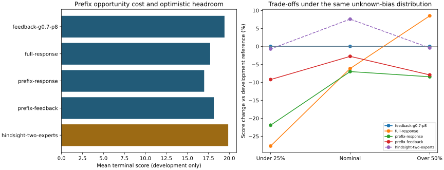

# One-shot expert selection: registered study

Terminal state: **`STOP_NO_HEADROOM`**.

The study asks whether a visible 16-period prefix can select between two frozen experts under unknown prediction bias. Full terminal utility includes the prefix cost. The reference is the strongest cheap development control, including direct observable calibration.

Training: 8 new markets. Development: 6 new markets, six focal advertisers and three bias groups per market. Statistical unit: market. Response seed: 11; feedback is immediate.

Frozen development reference: **`feedback-g0.7-p8`**. Development results and intervals below are exploratory, selected on this same split; they do not establish generalization.

| Method | Mean score | Relative to reference | Under | Nominal | Over |
| --- | ---: | ---: | ---: | ---: | ---: |
| `hindsight-two-experts` | 19.862 | +2.3% | -0.7% | +7.6% | -0.4% |
| `feedback-g0.7-p8` | 19.420 | +0.0% | +0.0% | +0.0% | +0.0% |
| `feedback-g0.7-p3` | 19.088 | -1.7% | +0.1% | -3.0% | -2.1% |
| `feedback-g1.2-p8` | 18.422 | -5.1% | -0.2% | -8.4% | -6.9% |
| `feedback-g0.3-p3` | 18.349 | -5.5% | -6.0% | -1.8% | -9.1% |
| `feedback-g0.3-p8` | 18.145 | -6.6% | -9.2% | -2.8% | -7.9% |
| `prefix-feedback` | 18.145 | -6.6% | -9.2% | -2.8% | -7.9% |
| `feedback-g1.2-p3` | 18.118 | -6.7% | -2.7% | -10.2% | -7.1% |
| `threshold-0.85` | 18.052 | -7.0% | -9.2% | -3.2% | -9.0% |
| `calibration-feedback-g0.3-p8-p8` | 18.028 | -7.2% | -3.8% | -13.2% | -4.1% |
| `mixture-50` | 17.912 | -7.8% | -11.7% | -2.1% | -9.9% |
| `full-response` | 17.711 | -8.8% | -27.7% | -6.2% | +8.5% |
| `threshold-1` | 17.680 | -9.0% | -11.2% | -5.9% | -9.9% |
| `prefix-response` | 16.997 | -12.5% | -21.9% | -7.0% | -8.4% |
| `calibration-feedback-g0.3-p8-p3` | 16.622 | -14.4% | -7.6% | -20.5% | -15.0% |
| `calibration-fixed-1.25-p8` | 14.593 | -24.9% | -18.0% | -19.9% | -37.7% |
| `fixed-1.25` | 14.033 | -27.7% | -18.0% | -21.0% | -45.6% |
| `calibration-fixed-1-p8` | 13.922 | -28.3% | -42.4% | -31.7% | -9.5% |
| `fixed-1` | 13.621 | -29.9% | -48.7% | -14.8% | -26.4% |
| `fixed-1.5` | 13.008 | -33.0% | -10.5% | -33.7% | -56.3% |
| `calibration-fixed-1.25-p3` | 12.782 | -34.2% | -35.9% | -33.2% | -33.4% |
| `calibration-fixed-1-p3` | 11.181 | -42.4% | -54.7% | -47.6% | -23.5% |
| `fixed-0.75` | 10.447 | -46.2% | -81.0% | -50.5% | -4.2% |
| `fixed-0.5` | 4.095 | -78.9% | -98.6% | -90.4% | -45.1% |

`hindsight-two-experts` uses future outcomes and is not deployable. It diagnoses this pair and this common prefix; it is not a general policy upper bound. All declared campaigns are included, including zero conversions and exhausted prefixes.

## Audit and interpretation

- The two continuations start from a copied queue, ledger, budget and actual history. Features are captured before continuations; hidden bias and final labels are never policy inputs.
- The selector fits a full-cycle advantage target. Its rejection threshold is operational, not a confidence interval.
- The simple calibration control observes arrived labels and accepted public probabilities; it does not receive a true correction factor.
- Full-day controls expose the opportunity cost of waiting for the common prefix.
- A failed development or budget gate leaves confirmation unopened. A registered stop closes this question without proving that all possible selectors fail.
- This study does not prove generative distributional value, delayed-feedback robustness, shared-budget competition, or industrial revenue impact.

[Protocol](../../docs/bidding-expert-selection-protocol.md) · [Reproduce](../../docs/bidding-expert-reproduction.md) · [All outcomes](results.csv) · [Public features and paired targets](features.csv) · [Statistics and candidates](summary.json) · [Source/input/weight provenance](provenance.json)
